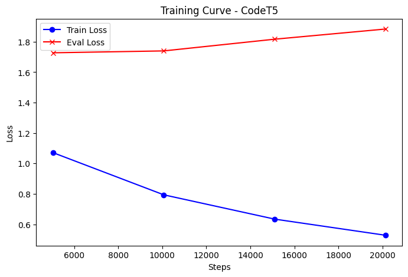
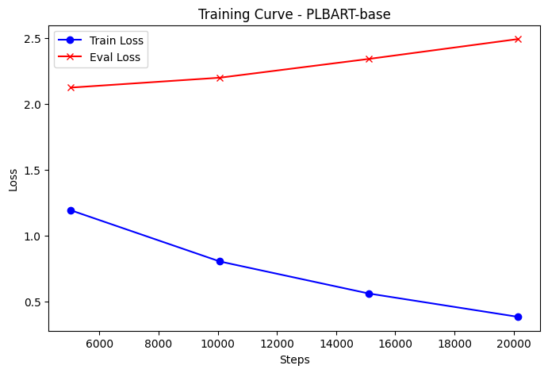
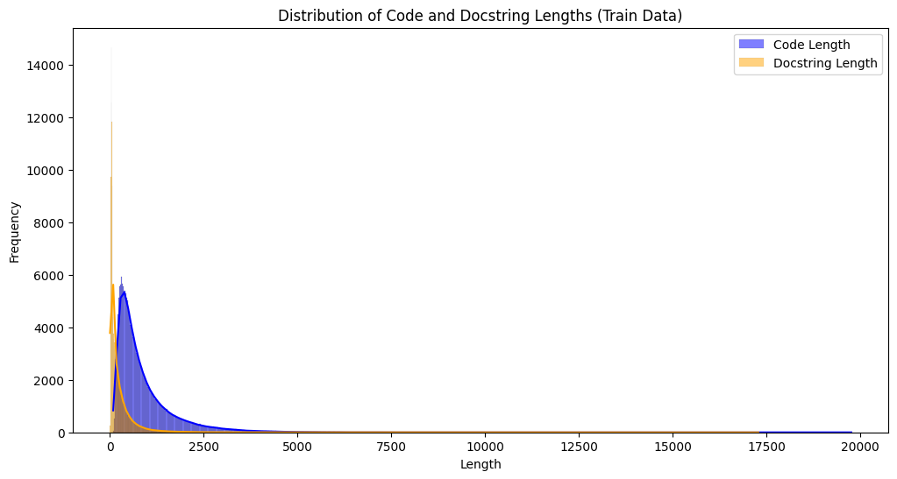
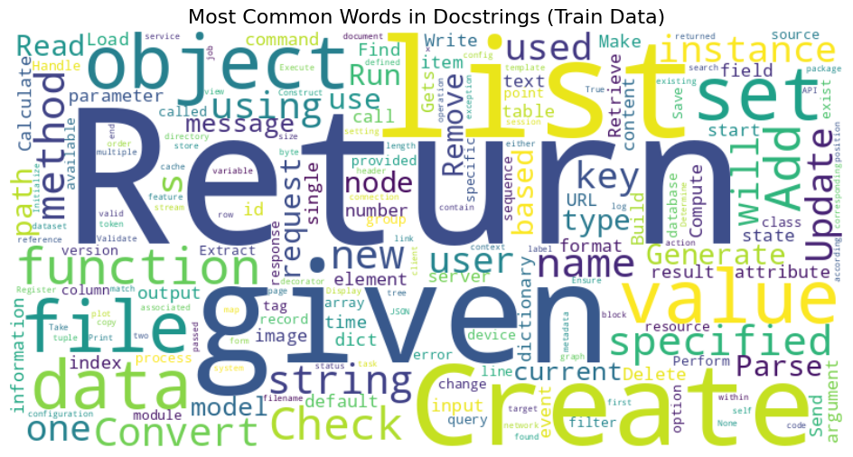

# Python Code Summarization with Pretrained Transformers

Fine-tuning pretrained sequence-to-sequence transformers to write a natural-language docstring for a Python
function, and comparing T5-small, BART-base, PLBART-base and CodeT5-base on the CodeXGLUE dataset.

[](https://github.com/Kiana8181/code-summarization-transformers/actions/workflows/notebook.yml)

- **Executed notebook (HTML):** <https://kiana8181.github.io/code-summarization-transformers/>
- **Results report (PDF):** [`outputs/code_summarization_transformers_results.pdf`](outputs/code_summarization_transformers_results.pdf)
- **Notebook:** [`notebooks/code_summarization_transformers.ipynb`](notebooks/code_summarization_transformers.ipynb)

> **Read this before using the scores.** About 25 % of the model inputs still contain the docstring the model has
> to predict, so **all scores below are inflated**. See [target leakage](#limitations). The results are useful for
> comparing the models with each other, not as an estimate of real summarization quality.

---

## Table of contents

1. [Project overview](#project-overview)
2. [Approach](#approach)
3. [Models](#models)
4. [Dataset](#dataset)
5. [Repository structure](#repository-structure)
6. [Installation](#installation)
7. [Dataset and model downloads](#dataset-and-model-downloads)
8. [Running the project](#running-the-project)
9. [Results](#results)
10. [Reproducing and interpreting the results](#reproducing-and-interpreting-the-results)
11. [Continuous integration and GitHub Pages](#continuous-integration-and-github-pages)
12. [Limitations](#limitations)

---

## Project overview

### Problem definition

Good documentation is expensive to write and quickly goes out of date. **Code summarization** generates a short
description from source code automatically. Here the input is a Python function and the output is its docstring,
which makes it a sequence-to-sequence problem between code and natural language.

### Objectives

- Explore the dataset: code and docstring lengths, common tokens, missing values and duplicates.
- Fine-tune general-purpose and code-specific pretrained transformers using the same pipeline.
- Evaluate with SacreBLEU and ROUGE.
- Inspect predictions on test data and on new code from outside the dataset.

## Approach

1. **Exploratory analysis** of the first 70 % / 60 % / 50 % of the train / validation / test splits.
2. **Preprocessing** (`tokenize_dataset`):
   - with a probability of 75 %, remove comments and docstrings from the code using regular expressions;
   - add the prefix `summarize: ` for the T5-based models;
   - tokenize code to at most 256 tokens and docstrings to at most 64 tokens, with padding to full length.
3. **Fine-tuning** with the Hugging Face `Seq2SeqTrainer`: batch size 2, learning rate 5e-5, mixed precision on a GPU.
   After each epoch the model generates predictions for the validation set, and the checkpoint with the best
   SacreBLEU is restored at the end.
4. **Evaluation:** test loss, SacreBLEU and ROUGE, then beam-search predictions (4 beams, at most 64 tokens) for three
   test samples and five functions from outside the dataset.

### The three runs

The models were trained in three separate sessions, with different data sizes. Each setting comes from that run's own
training log (steps = epochs × samples ÷ batch size) and evaluation size:

| Run | Models | Epochs | Training samples | Test samples | Training time (GPU) |
|---|---|---:|---:|---:|---|
| A | T5-small, PLBART-base | 4 | 10,072 (first 4 %) | 298 (first 2 %) | 28 and 34 min |
| B | BART-base, CodeT5 | 4 | 10,072 (first 4 %) | 298 (first 2 %) | 34 and 59 min |
| C | CodeT5 | 1 | 176,274 (first 70 %) | 7,459 (first 50 %) | 4 h 37 min |

The validation sizes are not recorded in the logs, so the notebook's `validation_fraction` is an assumption: 0.02 for
runs A and B, and 0.6 for run C, the fraction in the notebook's data cell. The code cells of runs B and C had been
overwritten after they ran, so `run_experiment` restores them from the loop that remained and from these logged settings.

## Models

| Label | Checkpoint | Description | Weights |
|---|---|---|---:|
| T5-small | [`t5-small`](https://huggingface.co/google-t5/t5-small) | Small general-purpose T5 | about 240 MB |
| BART-base | [`facebook/bart-base`](https://huggingface.co/facebook/bart-base) | General-purpose BART | about 560 MB |
| PLBART-base | [`uclanlp/plbart-base`](https://huggingface.co/uclanlp/plbart-base) | BART-style model pretrained on code | about 560 MB |
| CodeT5 | [`Salesforce/codet5-base`](https://huggingface.co/Salesforce/codet5-base) | T5 model pretrained on code | about 890 MB |

All models are loaded with `AutoModelForSeq2SeqLM`, so their heads and tokenizers come from the checkpoints.

**Implementation details**

- `run_experiment(labels, epochs, train_fraction, validation_fraction, test_fraction)` trains, plots, evaluates and
  prints predictions for each model. The fractions always select the **first** rows of a split.
- Checkpoints are written to `work/`. Run settings come from environment variables (`SUMMARIZATION_WORK_DIR`,
  `QUICK_RUN`), so the notebook runs unchanged locally, in Docker or in CI.

## Dataset

**CodeXGLUE code-to-text, Python configuration**, based on CodeSearchNet: functions with their docstrings, from public
GitHub repositories. No account is needed. The Python configuration is about 330 MB of Parquet files.

| Split | Rows | Used by the analysis | Used by runs A/B | Used by run C |
|---|---:|---:|---:|---:|
| train | 251,820 | 176,274 | 10,072 | 176,274 |
| validation | 13,914 | 8,348 | not recorded (278 assumed) | not recorded (8,348 assumed) |
| test | 14,918 | 7,459 | 298 | 7,459 |

Main columns: `repo`, `path`, `func_name`, `code`, `code_tokens`, `docstring`, `docstring_tokens`, `url`.

- Hugging Face: <https://huggingface.co/datasets/google/code_x_glue_ct_code_to_text>
- Original project, CodeXGLUE: <https://github.com/microsoft/CodeXGLUE>

Check those pages for the license and usage terms.

## Repository structure

```text
code-summarization-transformers/
├── .github/workflows/notebook.yml              # CI: executed notebook → index.html (Pages) + artifact
├── notebooks/
│   └── code_summarization_transformers.ipynb   # full pipeline, stored with the outputs of the GPU runs
├── outputs/
│   ├── figures/*.png                           # plots extracted from the notebook
│   ├── metrics.json                            # per-epoch and test metrics parsed from the stored outputs
│   └── code_summarization_transformers_results.pdf
├── scripts/
│   └── run_pipeline.py                         # execute notebook, export HTML, figures and PDF
├── requirements.txt
└── README.md
```

## Installation

### Prerequisites

- Python **3.10–3.12** (tested with 3.11)
- `git`
- For a full run, a CUDA GPU is strongly recommended. The stored runs took about 7.5 hours in total on a GPU. A CPU is
  enough for the quick smoke test.
- About 4 GB of disk space for the dataset and models, plus several GB of checkpoints in `work/`.
- Internet access on the first run.

### 1. Clone the repository

```bash
git clone https://github.com/Kiana8181/code-summarization-transformers.git
cd code-summarization-transformers
```

### 2. Create and activate a virtual environment

macOS / Linux:

```bash
python3.11 -m venv .venv
source .venv/bin/activate
```

Windows (PowerShell):

```powershell
py -3.11 -m venv .venv
.venv\Scripts\Activate.ps1
```

Windows (Command Prompt):

```bat
py -3.11 -m venv .venv
.venv\Scripts\activate.bat
```

### 3. Install the dependencies

With an NVIDIA GPU (Linux or Windows), install the default PyTorch build:

```bash
python -m pip install --upgrade pip
pip install -r requirements.txt
```

CPU only (smaller download):

```bash
python -m pip install --upgrade pip
pip install -r requirements.txt --extra-index-url https://download.pytorch.org/whl/cpu
```

`transformers` is pinned to 4.47.1 on purpose. The notebook uses APIs that later versions change or remove
(`as_target_tokenizer`, the `tokenizer=` argument of the trainer), and it loads `.bin` weights with PyTorch 2.5.

## Dataset and model downloads

You don't need to download anything by hand. On first use, the notebook downloads the dataset, the four models and the
two evaluation metrics from Hugging Face into its local cache (`~/.cache/huggingface`). To use a different location,
set the `HF_HOME` environment variable.

To fetch the dataset ahead of time:

```bash
python -c "from datasets import load_dataset; load_dataset('google/code_x_glue_ct_code_to_text', 'python')"
```

No further preparation is needed. Selecting subsets and tokenizing happen inside the notebook.

## Running the project

### Full run (reproduces all three runs, GPU recommended)

```bash
python scripts/run_pipeline.py --inplace --timeout 36000
```

This executes the notebook from a fresh kernel and writes the outputs back into it (`--inplace`). It also writes
`site/index.html`, `outputs/figures/` and the PDF report. To train only some models, edit the cells of runs A, B and C.

### Quick smoke test (CPU, about 4 minutes once the models are downloaded)

`QUICK_RUN=1` limits each split to 100 rows, uses 10 of them per run, and trains each model for one epoch. It checks
that the whole pipeline runs, including all four models; the resulting numbers are **not** meaningful. The command
writes to separate folders so that the stored results are not overwritten.

macOS / Linux:

```bash
QUICK_RUN=1 python scripts/run_pipeline.py --site-dir smoke/site --outputs-dir smoke/outputs --timeout 7200
```

Windows (PowerShell):

```powershell
$env:QUICK_RUN="1"
python scripts/run_pipeline.py --site-dir smoke/site --outputs-dir smoke/outputs --timeout 7200
```

### Export only (no training)

Rebuild `site/index.html`, the figures and the PDF from the outputs stored in the notebook. This is what CI does.

```bash
python scripts/run_pipeline.py --no-execute
```

### Interactive

```bash
pip install jupyterlab
jupyter lab notebooks/code_summarization_transformers.ipynb
```

## Results

The notebook is stored with the outputs of the real GPU runs. All numbers below come from those outputs and are also in
[`outputs/metrics.json`](outputs/metrics.json).

### Test set

SacreBLEU is on a 0–100 scale and ROUGE on a 0–1 scale. All scores are inflated by the [target leakage](#limitations).

| Run | Model | Training samples | Epochs | Test samples | Test loss | SacreBLEU | ROUGE-1 | ROUGE-2 | ROUGE-L |
|---|---|---:|---:|---:|---:|---:|---:|---:|---:|
| A | T5-small | 10,072 | 4 | 298 | 1.347 | 5.19 | 0.336 | 0.215 | 0.317 |
| A | PLBART-base | 10,072 | 4 | 298 | 1.370 | 5.99 | 0.354 | 0.227 | 0.333 |
| B | BART-base | 10,072 | 4 | 298 | 1.192 | 5.63 | 0.344 | 0.211 | 0.325 |
| B | **CodeT5** | 10,072 | 4 | 298 | 1.036 | **10.24** | **0.408** | **0.259** | **0.381** |
| C | CodeT5 | 176,274 | 1 | 7,459 | 1.016 | 7.60 | 0.403 | 0.256 | 0.378 |

### Predictions on new code

The input is an iterative `binary_search(nums, target)` that is not in the dataset. The output of each model:

| Run | Model | Prediction (first line) |
|---|---|---|
| A | T5-small | `Define binary_search(nums, target): left, right = 0, len(nums) - 1 while left = right...` |
| A | PLBART-base | `return -1 if no binary search` |
| B | BART-base | `Perform binary search on a list of integers.` |
| B | CodeT5 | `Returns the index of the binary search.` |
| C | CodeT5 | `Binary search for a given number.` |

CodeT5 also continues with `:param:` and `:return:` lines. All predictions are in the executed notebook.

### Visualizations

| Training curve: CodeT5, run B | Training curve: PLBART-base, run A |
|---|---|
|  |  |

| Code and docstring lengths | Common words in docstrings |
|---|---|
|  |  |

All 8 figures are in [`outputs/figures/`](outputs/figures) and in the PDF report.

## Reproducing and interpreting the results

1. Install the dependencies (GPU build).
2. Run `python scripts/run_pipeline.py --inplace --timeout 36000`.
3. Compare the printed metrics with the tables above. Comment removal and weight updates are random and not seeded, the
   validation sizes are assumptions, and library versions may differ from the stored runs, so a rerun will not reproduce
   the numbers exactly. The size of this variation has not been measured.

**How to read the metrics**

- **SacreBLEU** measures n-gram overlap with the reference docstring, and **ROUGE** measures overlap of words and word
  pairs. Both reward matching the exact wording of one reference, so a good summary phrased differently scores low.
- **CodeT5 is the best of the four** on equal data sizes (runs A and B) on every score. It was pretrained on code.
- **Do not compare 10.24 with 7.60.** Those two CodeT5 scores use different test sets. The first 298 test rows come from
  only two repositories (273 from `apache/airflow`), and test scores in runs A and B are far above their validation
  scores. In run C, validation and test SacreBLEU agree (7.30 and 7.60), so its number is the more trustworthy one.
- **Overfitting on the small subset.** In runs A and B, validation loss rises after the first or second epoch for PLBART,
  BART and CodeT5 while training loss keeps falling. Only T5-small's validation loss keeps improving.
- **On new code,** BART and CodeT5 give the most readable summaries, and T5-small mostly repeats the code.

## Continuous integration and GitHub Pages

The full run needs a GPU and about 7.5 hours, so CI does **not** retrain. The workflow
[`.github/workflows/notebook.yml`](.github/workflows/notebook.yml) runs on every push to `main`, on pull requests and on
manual dispatch, and:

1. installs only the export tools (`matplotlib`, `nbconvert`, `nbformat`);
2. runs `python scripts/run_pipeline.py --no-execute`, which turns the stored executed notebook into `site/index.html`
   with all outputs and plots, extracts the figures and builds the PDF report;
3. uploads `site/index.html` and `outputs/` as the downloadable workflow artifact **`notebook-results`**;
4. on `main`, deploys `index.html` to **GitHub Pages**.

No dataset, account or secret is needed in CI.

**One-time setup:** open **Settings → Pages** in the repository and set **Source** to **GitHub Actions**. The site is then
served at <https://kiana8181.github.io/code-summarization-transformers/>.

## Limitations

- **Target leakage (most important).** In this dataset the `code` field includes the function's docstring, which is also
  the target. `remove_comments_python` removes it only 75 % of the time, so about a quarter of the inputs, in training and
  in testing, still contain the answer. In the stored samples, models then simply copy it. Removing the docstring from every
  input and retraining would give an honest estimate.
- **Different data sizes.** Runs A/B and run C are not directly comparable, and runs A/B test on a small sample from only
  two repositories. Subsets are the first rows of each split, not random samples.
- **Padding counts in the loss.** Labels are padded with the pad token rather than `-100`, so the loss also rewards
  predicting padding, and its values look better than they are.
- **Missing prefix when generating.** `generate_predictions` omits the `summarize:` prefix that the T5-based models were
  trained with, which may contribute to T5-small's weak predictions on new code. Test metrics are not affected.
- **Reconstructed run cells.** The code cells of runs B and C were restored from the logs, and all validation sizes are
  assumptions. The stored outputs are the original ones.
- **Old library versions.** The notebook relies on `transformers` 4.47 APIs that later versions change or remove.

## Author

Kiana Hashemi
